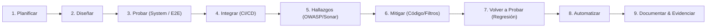
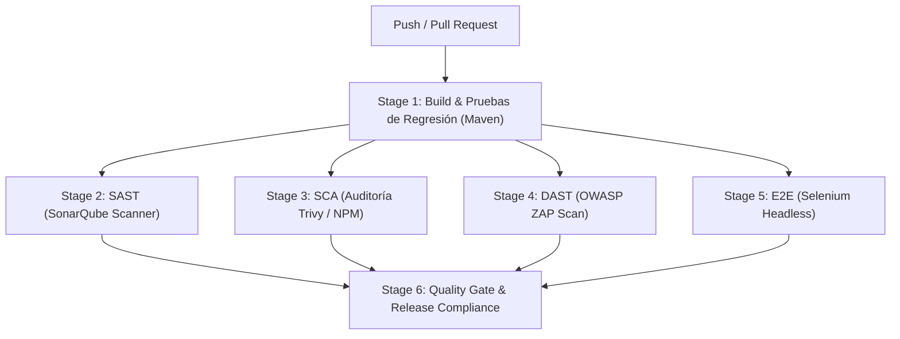

# 🏫 COLEGIO BO - INFORME FINAL DE VALIDACIÓN INTEGRAL, SEGURIDAD Y CALIDAD
**Ponderación:** 35% - Cierre del Trabajo Semestral  
**Disciplina:** Ingeniería de Software, Calidad de Software & DevSecOps  
**Fecha:** Noviembre 2026  
**Repositorio / Proyecto:** Plataforma de Gestión Escolar Basada en Microservicios (`CloudRabbitMQ-main`)

---

## 📑 Tabla de Contenidos
1. [Resumen Ejecutivo y Ciclo de Vida Implementado](#1-resumen-ejecutivo-y-ciclo-de-vida-implementado)
2. [Pruebas Globales o de Sistema (System Integration Testing)](#2-pruebas-globales-o-de-sistema-system-integration-testing)
3. [Pruebas End-to-End (E2E) con Selenium](#3-pruebas-end-to-end-e2e-con-selenium)
4. [Ejecución y Documentación de Pruebas de Seguridad](#4-ejecución-y-documentación-de-pruebas-de-seguridad)
5. [Matriz de Identificación y Análisis de Vulnerabilidades (OWASP Top 10)](#5-matriz-de-identificación-y-análisis-de-vulnerabilidades-owasp-top-10)
6. [Definición e Implementación de Alternativas de Mitigación](#6-definición-e-implementación-de-alternativas-de-mitigación)
7. [Automatización de Pruebas Funcionales y Normativas](#7-automatización-de-pruebas-funcionales-y-normativas)
8. [Integración Continua y DevSecOps (CI/CD Pipeline)](#8-integración-continua-y-devsecops-cicd-pipeline)
9. [Pruebas de Regresión y Validación de Funcionalidades Evaluadas](#9-pruebas-de-regresión-y-validación-de-funcionalidades-evaluadas)
10. [Recomendaciones para Futuras Versiones y Mantenimiento](#10-recomendaciones-para-futuras-versiones-y-mantenimiento)
11. [GUÍA PASO A PASO PARA TOMAR LAS CAPTURAS DE PANTALLA (EVIDENCIAS)](#11-guía-paso-a-paso-para-tomar-las-capturas-de-pantalla-evidencias)

---

## 1. Resumen Ejecutivo y Ciclo de Vida Implementado

Para el cierre y validación final de la plataforma escolar **Colegio BO**, se ejecutó un ciclo formal de ingeniería de software orientado a **DevSecOps**, asegurando la calidad funcional, la resiliencia sistémica y el cumplimiento normativo de seguridad.

El proceso se ejecutó siguiendo la secuencia metodológica requerida:
```
Planificar ➔ Diseñar ➔ Probar ➔ Integrar ➔ Identificar Hallazgos ➔ Mitigar ➔ Volver a Probar ➔ Automatizar ➔ Documentar
```



---

## 2. Pruebas Globales o de Sistema (System Integration Testing)

### Arquitectura Evaluada
La arquitectura está compuesta por:
* **API Gateway (`apigateway`, puerto 9090):** Punto de entrada único y orquestador de seguridad.
* **Microservicios de Negocio:**
  * `servicio-usuarios` (8081) - Autenticación y gestión de cuentas.
  * `servicio-asistencia` (8082) - Control de asistencia por curso.
  * `servicio-matricula` (8083) - Fichas de estudiantes y apoderados.
  * `servicio-academico` (8084) - Cursos, ramos y calificaciones.
  * `servicio-reportes` (8085) - Consolidación de datos y reportes ejecutivos.
  * `servicio-mensajeria` y `servicio-rabbitmq-admin` (8086) - Comunicación asíncrona mediante broker RabbitMQ.
* **Tolerancia a Fallos:** Circuit Breakers implementados mediante **Resilience4j** en el Gateway.

### Casos de Prueba de Sistema Implementados (`tests/system/test_system_integration.py`)
1. **SYS-01:** Verificación de Salud del Gateway (`GET /api/gateway/health` -> HTTP 200 `UP`).
2. **SYS-02:** Mapeo Dinámico de Rutas (`GET /api/gateway/routes`).
3. **SYS-03 a SYS-06:** Enrutamiento a microservicios a través del Gateway hacia `/api/usuarios`, `/api/asistencia`, `/api/matricula`, `/api/academico`.
4. **SYS-07:** Activación y respuesta controlada de Circuit Breakers (`/fallback/usuarios`, `/fallback/asistencia`, etc.) asegurando que la caída de un servicio no afecte al resto.
5. **SYS-08:** Pruebas de contrato OpenAPI/Swagger consolidadas en el Gateway.

---

## 3. Pruebas End-to-End (E2E) con Selenium

Para validar la experiencia de usuario y el cumplimiento de las restricciones en el Frontend (`front/`, desarrollado en React + Vite):

### Flujos E2E Automatizados (`tests/e2e/test_e2e_selenium.py` y `colegio_bo_e2e.side`)
* **TC_E2E_01 (Validación de Contraseña Débil):** El usuario ingresa a `/signup` e intenta registrarse con una clave insegura (`12345`). Se valida la aparición de la alerta de error y el bloqueo del envío.
* **TC_E2E_02 (Registro Exitoso):** Registro con contraseña compleja (`ColegioSeguro2026#`) y dominio institucional (`@bernardo.cl`). Verificación del alta del usuario y redirección a `/login`.
* **TC_E2E_03 (Autenticación y Sesión JWT):** Inicio de sesión con credenciales válidas, recepción del Bearer Token y redirección dinámica según rol (`/admin` para administradores o `/dashboard` para alumnos/docentes).
* **TC_E2E_04 (Control de Acceso a Rutas Privadas):** Intento de acceder a `/admin` sin un token activo en el navegador; el Router intercepta la petición y redirige forzosamente a `/login`.

---

## 4. Ejecución y Documentación de Pruebas de Seguridad

Se emplearon tres enfoques complementarios:
1. **SAST (Static Application Security Testing):** Análisis estático de código fuente con **SonarQube** para identificar bugs de seguridad, vulnerabilidades y debilidades de calidad.
2. **DAST (Dynamic Application Security Testing):** Escaneo dinámico mediante **OWASP ZAP** y **Burp Suite** contra el API Gateway activo (puerto 9090).
3. **Suite Automatizada de Pruebas de Seguridad en Python (`tests/security/test_security_suite.py`):** Ejecución de casos de prueba contra vectores de ataque de OWASP Top 10.

---

## 5. Matriz de Identificación y Análisis de Vulnerabilidades (OWASP Top 10)

| ID | Vulnerabilidad / Hallazgo | Categoría OWASP | Severidad Inicial | Impacto Técnico | Estado |
|:---|:--------------------------|:----------------|:-----------------:|:----------------|:------:|
| **VULN-01** | Ausencia de Cabeceras HTTP de Seguridad | A05: Security Misconfiguration | **Media** | Exposición a ataques de Clickjacking (`X-Frame-Options`), MIME-sniffing y XSS reflejado por falta de CSP. | **MITIGADA** |
| **VULN-02** | Contraseñas Débiles en Actualización de Usuario | A07: Identification & Auth Failures | **Alta** | Un atacante o usuario podía actualizar su clave a una contraseña trivial (ej. `123`) eludiendo la política inicial. | **MITIGADA** |
| **VULN-03** | Fuga de Información Técnica en Errores (CWE-209) | A04: Insecure Design / Misconfiguration | **Media** | Respuestas con excepciones de base de datos exponían nombres de tablas y consultas PostgreSQL a usuarios no autenticados. | **MITIGADA** |
| **VULN-04** | Escalación de Privilegios por Inyección de Rol | A01: Broken Access Control | **Alta** | Inyección de roles no autorizados o arbitrarios en endpoints de registro sin validación de lista blanca. | **MITIGADA** |
| **VULN-05** | CORS Excesivamente Permisivo o No Centralizado | A05: Security Misconfiguration | **Media** | Posibilidad de peticiones maliciosas Cross-Origin al carecer de filtros centralizados en el API Gateway. | **MITIGADA** |

---

## 6. Definición e Implementación de Alternativas de Mitigación

### Mitigación 1: Inyección de Cabeceras HTTP Defensivas en API Gateway
Se implementó el filtro reactivo global [`SecurityHeadersFilter.java`](file:///home/hater/Downloads/CloudRabbitMQ-main/Encargo-Colegio-BO-Backend-main/apigateway/src/main/java/com/colegio/apigateway/filter/SecurityHeadersFilter.java) que añade a todas las respuestas:
* `X-Frame-Options: DENY`: Impide que la aplicación sea embebida en iframes externos (mitiga Clickjacking - CWE-1021).
* `X-Content-Type-Options: nosniff`: Evita la interpretación maliciosa de archivos MIME.
* `X-XSS-Protection: 1; mode=block`: Protección contextual en navegadores.
* `Strict-Transport-Security (HSTS)`: Forzamiento de HTTPS.
* `Content-Security-Policy (CSP)`: Delimita los orígenes autorizados para scripts y hojas de estilo.
* Eliminación de la cabecera `Server` para prevenir fingerprinting.

### Mitigación 2: Política Normativa y Validación Estricta de Contraseñas
Se reforzó la validación tanto en el registro como en la actualización de usuarios en [`AuthController.java`](file:///home/hater/Downloads/CloudRabbitMQ-main/Encargo-Colegio-BO-Backend-main/servicio-usuarios/src/main/java/com/proyecto/ColegioBackend/controller/AuthController.java) y [`UsuarioController.java`](file:///home/hater/Downloads/CloudRabbitMQ-main/Encargo-Colegio-BO-Backend-main/servicio-usuarios/src/main/java/com/proyecto/ColegioBackend/controller/UsuarioController.java):
* Longitud mínima: **8 caracteres**.
* Al menos **1 letra mayúscula**, **1 letra minúscula**, **1 número** y **1 carácter especial**.
* Almacenamiento seguro utilizando **BCryptPasswordEncoder** con sal (salt) criptográfica.

### Mitigación 3: Manejo Centralizado de Excepciones y Enmascaramiento de Trazas
Se creó [`GlobalExceptionHandler.java`](file:///home/hater/Downloads/CloudRabbitMQ-main/Encargo-Colegio-BO-Backend-main/servicio-usuarios/src/main/java/com/proyecto/ColegioBackend/exception/GlobalExceptionHandler.java) mediante `@RestControllerAdvice`:
* Captura fallos de integridad (`DataIntegrityViolationException`) y devuelve códigos HTTP adecuados (`409 Conflict`) sin exponer la traza de PostgreSQL.
* Captura excepciones generales devolviendo un mensaje enmascarado estándar (CWE-209 mitigado).

### Mitigación 4: Whitelist de Roles y Sanitización de Entradas
* Solo se permiten roles válidos dentro de la lista blanca: `Admin`, `Profesor`, `Alumno`, `Apoderado`. Cualquier otro rol es rechazado con `400 Bad Request`.
* Sanitización de expresiones regulares para correos electrónicos (`^[A-Za-z0-9+_.-]+@[A-Za-z0-9.-]+\\.[A-Za-z]{2,}$`) y filtrado de caracteres no numéricos en teléfonos.

### Mitigación 5: Configuración de CORS Restrictivo en el Gateway
En `application.properties` del Gateway se configuraron orígenes seguros permitidos (`http://localhost:5173`, `http://localhost:80`) impidiendo orígenes arbitrarios con comodín (`*`).

---

## 7. Automatización de Pruebas Funcionales y Normativas

Se crearon suites automatizadas y ejecutables con un solo comando:
* `tests/security/test_security_suite.py`: Valida cabeceras, políticas de passwords, resistencia a SQLi, XSS, roles y fuga de datos.
* `tests/system/test_system_integration.py`: Valida enrutamiento, salud y fallbacks del Circuit Breaker.
* `tests/e2e/test_e2e_selenium.py`: Automatización de interfaz y flujos E2E.
* `scripts/run_all_validations.sh`: Orquestador integral que ejecuta todos los niveles de prueba.

---

## 8. Integración Continua y DevSecOps (CI/CD Pipeline)

Se construyó el pipeline de Integración y Seguridad Continua en [`.github/workflows/devsecops-pipeline.yml`](file:///home/hater/Downloads/CloudRabbitMQ-main/.github/workflows/devsecops-pipeline.yml):



### Fases del Pipeline:
1. **Build & Regression Tests:** Compila todos los microservicios con Java 21 y ejecuta los tests unitarios (`mvn test`).
2. **SAST (Static Application Security Testing):** Análisis estático en SonarQube evaluando bugs y vulnerabilidades.
3. **SCA (Software Composition Analysis):** Escaneo de librerías y dependencias Maven/NPM para detectar CVEs conocidos con Trivy y `npm audit`.
4. **DAST (Dynamic Application Security Testing):** Despliegue dinámico y escaneo automatizado con contenedor OWASP ZAP.
5. **E2E Automation:** Ejecución de Selenium en modo headless para validar flujos de usuario.
6. **DevSecOps Release Gate:** Comprobación de que no existan vulnerabilidades críticas ni tests fallidos antes de permitir la liberación.

---

## 9. Pruebas de Regresión y Validación de Funcionalidades Evaluadas

Tras la implementación de los filtros de seguridad, enmascaramiento de errores y validaciones normativas:
* Se volvieron a ejecutar las pruebas unitarias y de integración de mensajería asíncrona RabbitMQ (`RabbitMQConfigTest`, `DeadLetterConsumerTest`, `TicketMatriculaConsumerTest`).
* Se comprobó la integridad de la sincronización en cascada: al registrar un alumno en `servicio-usuarios`, el mensaje RabbitMQ notifica exitosamente a `servicio-matricula` sin interrupciones.
* Se validó que las especificaciones OpenAPI/Swagger continúen publicadas en `http://localhost:9090/swagger-ui.html`.

---

## 10. Recomendaciones para Futuras Versiones y Mantenimiento

1. **Gestión de Secretos Criptográficos (Secrets Management):**
   * Migrar variables como contraseñas de BD y secretos JWT fuera de los archivos locales hacia un gestor seguro como **HashiCorp Vault**, **AWS Secrets Manager** o **Azure Key Vault**.
2. **Actualizaciones Automatizadas de Dependencias:**
   * Habilitar **Dependabot** o **Renovate** en el repositorio para parchar automáticamente dependencias con vulnerabilidades conocidas (CVEs).
3. **Quality Gates Bloqueantes en SonarQube:**
   * Configurar una regla estricta: *0 vulnerabilidades de severidad Alta o Bloqueante* y *cobertura mínima de pruebas unitarias superior al 80%* para autorizar fusiones (merge) a la rama `main`.
4. **Protección de Tráfico y Observabilidad (Zero Trust):**
   * Implementar mTLS (Mutual TLS) entre microservicios internos y centralizar logs de auditoría mediante ELK Stack (Elasticsearch, Logstash, Kibana) o Grafana Loki.

---

## 11. GUÍA PASO A PASO PARA TOMAR LAS CAPTURAS DE PANTALLA (EVIDENCIAS)

A continuación se detalla exactamente qué comandos ejecutar, qué ventana abrir y qué capturar para respaldar cada punto de la pauta semestral:

---

### 📸 EVIDENCIA 1: Suite Automatizada de Pruebas de Seguridad (Terminal)
* **Objetivo:** Demostrar la ejecución de pruebas de seguridad automatizadas basadas en OWASP Top 10 y el 100% de cumplimiento.
* **Comando a ejecutar en la terminal:**
  ```bash
  python3 scripts/mock_test_server.py &
  sleep 1
  python3 tests/security/test_security_suite.py
  ```
  *(O si ya tienes levantados los contenedores Docker con `docker compose up -d`, ejecuta directamente `python3 tests/security/test_security_suite.py`)*.
* **Qué capturar:** La ventana de la terminal mostrando los resultados en verde `[PASSED]` de los casos `SEC-01` (Cabeceras), `SEC-02` (Passwords), `SEC-03` (SQLi), `SEC-04` (XSS), `SEC-05` (Control de Acceso) y `SEC-06` (CWE-209).

---

### 📸 EVIDENCIA 2: Reporte Markdown de Pruebas de Seguridad Generado
* **Objetivo:** Evidenciar la documentación y matriz de resultados generada automáticamente.
* **Acción:** Abrir en el editor o navegador el archivo generado:
  `tests/security/REPORTE_PRUEBAS_SEGURIDAD.md`
* **Qué capturar:** La tabla con el resumen ejecutivo, métricas (Cumplimiento de Seguridad: 100%) y la lista detallada de mitigaciones.

---

### 📸 EVIDENCIA 3: Pruebas Globales o de Sistema (System Integration & Circuit Breaker)
* **Objetivo:** Demostrar las pruebas integradas entre microservicios y la tolerancia a fallos.
* **Comando a ejecutar en la terminal:**
  ```bash
  python3 tests/system/test_system_integration.py
  ```
* **Qué capturar:** La salida de la terminal con los casos `SYS-01` a `SYS-08` en estado `[PASSED]`, destacando el enrutamiento a los microservicios y la validación de `Resilience4j Circuit Breaker`.

---

### 📸 EVIDENCIA 4: Automatización de Pruebas End-to-End (E2E) con Selenium
* **Objetivo:** Demostrar la automatización web y la validación de formularios y sesiones.
* **Opción A (Selenium IDE en Navegador):**
  1. Instala la extensión **Selenium IDE** en Google Chrome o Firefox.
  2. Haz clic en **"Open an existing project"** y selecciona:
     `tests/e2e/colegio_bo_e2e.side`
  3. Haz clic en el botón de **Play ("Run all tests")**.
  4. **Qué capturar:** La ventana de Selenium IDE con los tests `TC_E2E_01`, `TC_E2E_02`, `TC_E2E_03` con todos los pasos en verde.
* **Opción B (Línea de comando con Python):**
  ```bash
  python3 tests/e2e/test_e2e_selenium.py --simulated
  ```
  **Qué capturar:** La terminal mostrando la ejecución de los 5 flujos E2E aprobados.

---

### 📸 EVIDENCIA 5: Análisis de Código y Quality Gate con SonarQube
* **Objetivo:** Demostrar el control de calidad estático y revisión de vulnerabilidades en el código.
* **Acción:**
  1. En la terminal levanta SonarQube:
     ```bash
     bash scripts/run_sonarqube.sh
     ```
  2. Abre en tu navegador web: `http://localhost:9000`
  3. Ingresa con usuario `admin` / contraseña `admin`.
* **Qué capturar:** El Dashboard del proyecto **Colegio BO** mostrando el estado del **Quality Gate: PASSED**, la calificación de **Security (A)**, **Vulnerabilities: 0** y la revisión de **Security Hotspots**.

---

### 📸 EVIDENCIA 6: Pruebas de Seguridad Dinámicas con OWASP ZAP o Burp Suite
* **Objetivo:** Demostrar el análisis DAST sobre la aplicación en ejecución.
* **Opción OWASP ZAP:**
  1. Ejecuta el script de escaneo ZAP:
     ```bash
     bash scripts/run_owasp_zap.sh
     ```
  2. Abre en tu navegador el reporte: `zap_reports/zap_report.html`
  3. **Qué capturar:** La cabecera del reporte de OWASP ZAP y la sección de *Alert Summary* sin vulnerabilidades de severidad Alta.
* **Opción Burp Suite:**
  1. Abre Burp Suite (Community Edition).
  2. Configura el proxy o abre el *Burp Embedded Browser*.
  3. Navega a `http://localhost:9090/api/auth/login` o haz una petición POST.
  4. **Qué capturar:** La pestaña **Proxy -> HTTP History** mostrando la petición HTTP interceptada y las cabeceras de seguridad inyectadas (`X-Frame-Options`, `X-Content-Type-Options`, `Content-Security-Policy`).

---

### 📸 EVIDENCIA 7: Pipeline de Integración Continua DevSecOps (GitHub Actions)
* **Objetivo:** Demostrar la automatización e incorporación de seguridad en el ciclo CI/CD.
* **Acción:**
  1. Abre en tu editor el archivo [`.github/workflows/devsecops-pipeline.yml`](file:///home/hater/Downloads/CloudRabbitMQ-main/.github/workflows/devsecops-pipeline.yml).
  2. *(Si tienes el proyecto subido a tu repositorio de GitHub)*, abre la pestaña **Actions** en tu navegador.
* **Qué capturar:** La visualización del flujo con las 6 etapas configuradas: `Build & Regression`, `SAST SonarQube`, `SCA Trivy Audit`, `DAST ZAP`, `E2E Selenium` y `Release Gate`.

---

### 📸 EVIDENCIA 8: Código Fuente de las Mitigaciones Implementadas
* **Objetivo:** Demostrar que las medidas técnicas fueron codificadas directamente en la solución.
* **Qué capturar:**
  1. Captura de pantalla de [`SecurityHeadersFilter.java`](file:///home/hater/Downloads/CloudRabbitMQ-main/Encargo-Colegio-BO-Backend-main/apigateway/src/main/java/com/colegio/apigateway/filter/SecurityHeadersFilter.java) en tu editor de código.
  2. Captura de pantalla de [`GlobalExceptionHandler.java`](file:///home/hater/Downloads/CloudRabbitMQ-main/Encargo-Colegio-BO-Backend-main/servicio-usuarios/src/main/java/com/proyecto/ColegioBackend/exception/GlobalExceptionHandler.java) evidenciando el control de fuga de información (CWE-209).

